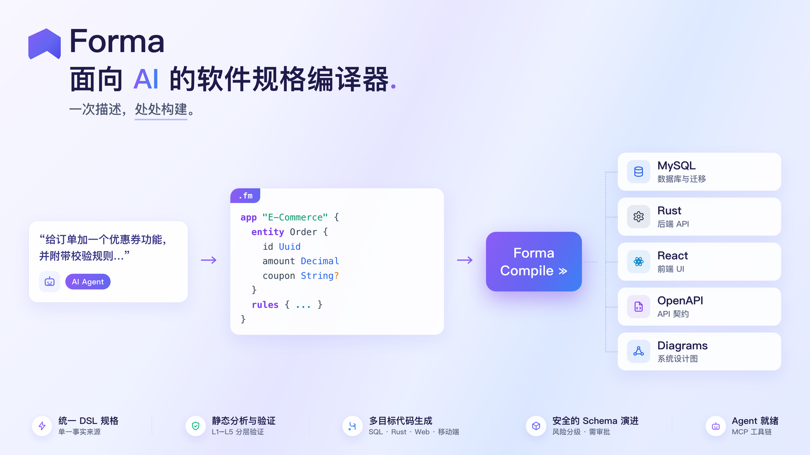

<div align="center">

```
 ███████╗ ██████╗ ██████╗ ███╗   ███╗ █████╗
 ██╔════╝██╔═══██╗██╔══██╗████╗ ████║██╔══██╗
 █████╗  ██║   ██║██████╔╝██╔████╔██║███████║
 ██╔══╝  ██║   ██║██╔══██╗██║╚██╔╝██║██╔══██║
 ██║     ╚██████╔╝██║  ██║██║ ╚═╝ ██║██║  ██║
 ╚═╝      ╚═════╝ ╚═╝  ╚═╝╚═╝     ╚═╝╚═╝  ╚═╝
```

# 一套 DSL，所有平台

**Forma 是一层 DSL 中间层：一套 DSL 描述前端、后端、数据库与规则，适配层（编译器）把它变成各平台的完整代码。**



[](LICENSE)
[](https://www.rust-lang.org/)
[](#开发)
[](#AI-接入mcp)
[](docs/roadmap.zh-CN.md)

[English](README.md) | **简体中文**

</div>

## 核心思想

一次典型的 AI Coding 会话，大部分 Token 消耗在**语言税**上：分号、`public static void`、import、HTML 标签配对——以及最贵的**重复税**：加一个字段，要把同一个事实在 SQL、类型、校验器、路由、表单、测试里逐 Token 写六遍。

Forma 在 AI 和代码之间放一层**中间层**：

```text
AI 只写 DSL（纯语义，约占传统方式 1% 的 Token）
        │
        ▼
┌─────────────────────────────────────────────┐
│           Forma 编译器（Rust）                │
│  parse → 语义图 → check → emit               │
└──────┬───────────────┬──────────────┬───────┘
       ▼               ▼              ▼
   MySQL DDL      Rust 后端        React Web
   （含迁移）      （axum + sqlx）  （TanStack + shadcn/ui）
                                     （iOS/Android → 后续适配层）
```

**一套 DSL 是数据、规则、API、页面的唯一事实来源。更新 DSL → 执行编译器 → 得到新代码**——所有平台同步。规则是一等公民：DSL 里写一次，编译为**后端权威校验（Rust）**与**同源前端校验（zod）**。

> 一句话说：**AI 成为意图表达者，适配层成为打字员**——确定性的、增量的、免费的。
>
> Forma 的定位是 **AI-Native Specification Compiler（面向 AI 的规格编译器）**：AI 生产软件规格，
> Forma 把规格编译为确定性、可验证、可审计的工程产物。它的差异化不是「生成更多语言」，
> 而是「安全地改变一个真实的软件系统」——见 [验证体系](docs/verification.zh-CN.md) 与
> [Agent 工作流](docs/agent-workflow.zh-CN.md)。

深入阅读：[设计理念](docs/philosophy.zh-CN.md) · [架构蓝图 v0.3](docs/architecture.zh-CN.md) · [架构治理体系](docs/architecture/README.md) · [DSL 语言规范](docs/dsl-spec.zh-CN.md) · [验证体系（L1–L5）](docs/verification.zh-CN.md) · [迁移安全](docs/migration-safety.zh-CN.md) · [Agent 工作流](docs/agent-workflow.zh-CN.md) · [近期里程碑](docs/next-milestone.zh-CN.md)

## 一个文件看懂 DSL

```fm
entity Order {
  id            Uuid          @id @default(uuid)
  customerEmail Email         @required
  amount        Decimal(12,2) @required @min(0.01)
  status        OrderStatus   @default(pending)
  createdAt     Timestamp     @default(now) @readonly
}

rules OrderRules {
  field Order.amount {
    min 0.01 { zh "金额必须大于 0" en "Amount must be positive" }
  }
  guard Order.delete {
    deny status == "approved"
      reason { zh "已审批订单不可删除" en "Approved orders cannot be deleted" }
  }
}

api Orders {
  entity Order
  operations [list get create update delete]
  list { filters [status] search [customerEmail] sort [createdAt desc] }
}

page OrderList {
  route "/orders"
  title { zh "订单列表" en "Orders" }
  table {
    query   Orders.list
    columns [createdAt: datetime, customerEmail, amount: money, status: badge]
    actions { create → OrderEdit, row [edit, delete confirm] }
  }
}
```

DSL 里没有 axum、没有 React、没有 SQL——页面是目标无关的抽象原语（`table`/`form`/`detail`），组件偏好是 target 配置。完整语法：[DSL 规范](docs/dsl-spec.zh-CN.md)。

## 适配层目标

| 目标 | 技术栈（当前） | 生成产物 |
|---|---|---|
| 数据库 | **MySQL 8**（InnoDB, utf8mb4） | 不可变基线 + 版本化 upgrade/rollback 迁移 |
| 案例数据 | **gen-seed**（确定性，非 AI 数据） | 版本化 `db/seed/seed_{version}.sql` + 与 API 契约对齐的 JSON fixtures |
| 后端 | **Rust**（axum + sqlx） | models、validators、routes、repositories |
| Web | **React + TanStack Router/Query + shadcn/ui** | 类型化路由、Query hooks、表单、zod schema |
| 可视化 | **Chart IR → ECharts Adapter → React Runtime** | `chart` 块 → ECharts option + 按需加载运行时（确定性投影、可换适配层），见 [RFC-0010](docs/architecture/rfc/RFC-0010-visualization.zh-CN.md) |
| 移动端 | **Flutter**（Android / iOS 同源） | models、REST 客户端、与后端/Web 同源的校验规则、Material 页面 |

## 版本化迁移（多版本）

Schema 演进与真实工程一致：DSL 是唯一事实源，每次变更编译为一对带编号的
**升级 + 回滚迁移**，追加进版本台账，SQL 更新全程可见。

```text
forma build  (v0.1.0)   →  0001_init.sql                        # 不可变基线（仅首次）
forma build  (v0.2.0)   →  0002_upgrade.sql + 0002_rollback.sql  # 升级 + 回滚配对
forma build  (v0.3.0)   →  0003_upgrade.sql + 0003_rollback.sql
                        →  MIGRATIONS.md                        # 每个版本的 SQL 更新轨迹
```

每对迁移都按 **MySQL 安全顺序**生成（先删约束 → 加列/改列 → 加约束 → 最后删列），
索引名由**列签名内容派生**（`idx_{表}_{列…}`），长链重放不会遇到重名索引或缺列错误。

重放模拟器（`emit/replay.rs`）以真实 MySQL 语义执行生成的 SQL 子集——不需要数据库——
为下面的能力提供保证。

CLI 管理整条版本链：

```bash
forma migrate [dir] status            # 每个版本的 applied / pending 状态
forma migrate [dir] history           # 完整版本历史
forma migrate [dir] up [--to v]       # 前进到指定版本；--apply 标记已应用
forma migrate [dir] down [--steps N] [--to v]   # 回滚 N 步 / 回滚到目标版本之上
forma migrate [dir] verify            # 链完整性 + 前向重放一致性（可直接进 CI）
forma migrate [dir] risk             # 按破坏性给待执行变更分级（Low/Medium/High/Extreme）
```

`verify` 检查：编号连续 · 每个升级都有配对回滚 · 台账哈希与文件一致（篡改检测）·
重放 `0001…000N` 的结果等于当前 DSL schema（基线漂移检测）。有漂移时退出码为 1。

活示例：[`examples/school/db/migrations/`](examples/school/db/migrations/) —— 真实三版本链：
v0.1.0（CRUD 基线）→ v0.2.0（竞选功能：3 新表 + 外键）→ v0.3.0（加 `phone`/`remark`、
拓宽 `title`、加 voter 索引），`MIGRATIONS.md` 展示每个版本完整 SQL。各版本 DSL 快照在
`examples/school/v1/`、`v2/`。applied 状态存在 `.forma/migrations.json`（git-ignored，
本机状态）；迁移 SQL 本身入库提交。

## 状态与路线图

**v0.3（当前）**——DSL 中间层架构定案；`@generated` 产物、分层验证（L1–L5）、RFC 治理体系齐备。

> **范围决议（2026-11-08）**：P2 只完成「余项 Closure」（8/8），**目标扩栈（Wave 4 的企业级技术栈）已撤销、不再排期**；
> P3 治理收尾与发布就绪已完成。当前处于 **发布前一致性收口**：把最近 49 个本地提交（Studio V3 本地历史回放、
> 可视化 V0.4–V0.6、CLI 端到端回归）同步回 README / RFC / roadmap / Conformance 叙事。
> 详见 [P2 规划](docs/architecture/roadmap/p2-plan.zh-CN.md) / [P3 规划](docs/architecture/roadmap/p3-plan.zh-CN.md)。

波次与当前状态：

- **Wave 1（M1–M4）** ✅ 端到端闭环：DSL 内核 → MySQL → Rust 后端 → React Web
- **Wave 2（M5–M8）** ✅ Auth 模块 · **Studio v1 可视化** · **生态互通**（OpenAPI/SQL/Postman 双向）· AI 语义补丁闭环
- **Wave 3（M9–M10）** ✅ 工程化（Docker/上传/导出/审计）+ Studio 双向编辑 · 扩栈：PostgreSQL/SQLite、Node/Python 后端、Vue/Next.js、Expo、GraphQL、多租户、实时
- **Wave 4（M11）** ✅ 部署产物（K8s manifests / Helm / Terraform）；**企业级扩栈（Spring/Go/.NET、原生移动、小程序、工作流运行时、支付）已撤销**
- **可视化 V0.4–V0.6** ✅ Dashboard 联动/下钻、AntV（G2Plot）、legend/tooltip、size/label、GIS 地图、工业监控阈值线、K 线
- **Studio V3 本地收尾** ✅ 变更历史面板 + patchId 幂等回放（多人实时协作仍明确排除）
- **P2 / P3** ✅ P2 轨道 A 8/8 完成（轨道 B 撤销）；P3 治理收尾与发布就绪

仓库当前含一个可运行的**标准联邦原型**（v0.2，Rust：适配器 + doctor + 增量构建 + 事务式补丁 + MCP，17 个测试全绿）。其语义图、补丁与构建引擎被 DSL 编译器复用；标准适配器转为导出视图（M7）。演化史：[docs/history/](docs/history/README.md)。

完整路线图（含每个里程碑的验收标准）：[docs/roadmap.zh-CN.md](docs/roadmap.zh-CN.md)。

多轮次迭代案例与能力完整性验收矩阵：[docs/case-protocol.zh-CN.md](docs/case-protocol.zh-CN.md)。

## 开发（当前原型）

```bash
cargo test            # 561 项 / 92 个集成测试套件
cargo build --release
cargo run -- migrate examples/school status      # 数据库版本链
cargo run -- migrate examples/school verify      # 链完整性 + 重放校验
cargo run -- build examples/school               # 全目标：db/backend/web/openapi/diagrams/seed/flutter
cargo run -- doctor examples/order-management    # 联邦时期示例命令
```

## 参与贡献

欢迎 PR——见 [CONTRIBUTING.md](CONTRIBUTING.md)（含设计宪法）。请遵守[行为准则](CODE_OF_CONDUCT.md)。安全问题：[SECURITY.md](SECURITY.md)。变更记录：[CHANGELOG.md](CHANGELOG.md)。

## 开源协议

[MIT](LICENSE) © Forma Contributors
